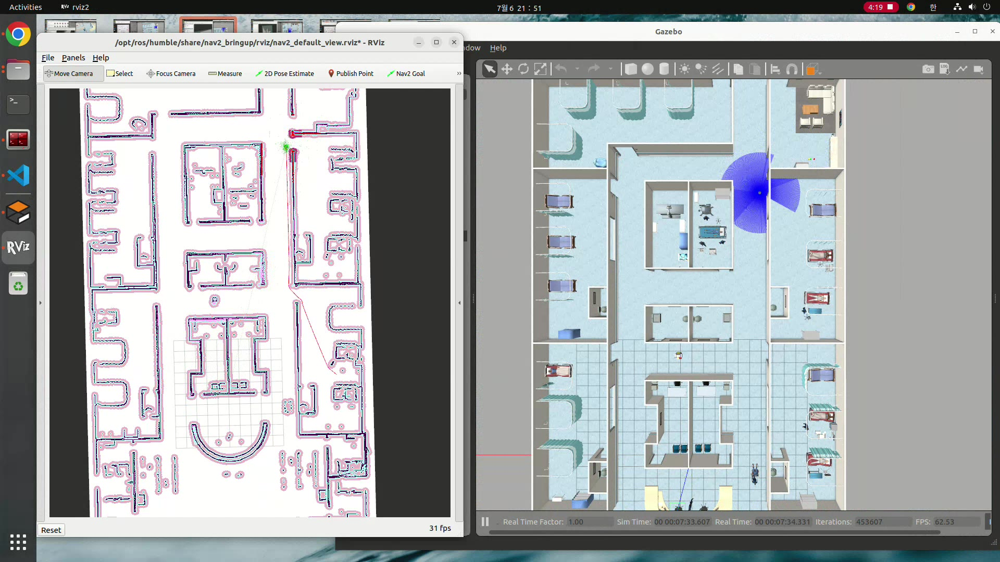
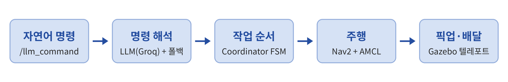

# 자연어 명령 병원 백신 배달 로봇

> 말 한 문장으로 약국에서 백신을 받아 병실로 배달하는 시뮬레이션 로봇 · 1명 · 내 역할: 기획·구현 전 과정



▶ [데모 영상 (demo/demo.webm)](demo/demo.webm)

## 결과

- 배달 범위: 좌표 2곳(A/B) → 약국 1곳 + 병실 4곳(301~304호), 백신 4종(A/B/AB/O형)
- 명령 방식: 좌표 지정 → 자연어 한 문장 (LLM이 없으면 규칙 기반 폴백으로 계속 동작)

## 문제

원본 캡스톤 키트는 TurtleBot4 + Gazebo Ignition + Docker 환경이라 내 PC에서 그대로 돌릴 수 없었고, 좌표 2개(A/B)만 오가는 단순 pick & place였다. 실제 병원처럼 여러 병실·여러 물품을 자연어 한 문장으로 지시할 수 있게 만드는 것이 목표였다.

## 내 역할 (1명, 전 과정)

- TurtleBot4·Ignition·Docker 키트를 TurtleBot3·Gazebo classic 네이티브 환경으로 옮겼다
- AWS RoboMaker 병원 월드를 넣고 완성 지도(map_server + AMCL) 위에서 주행하도록 바꿨다
- 병원 월드에 맞게 Nav2·AMCL 파라미터를 조정했다
- 병실 4곳·약국 좌표(rooms.yaml)와 백신 4종 매핑(vaccines.yaml)을 만들었다
- LLM(Groq) 명령 해석 노드와 규칙 기반 폴백 파서를 연결했다
- Gazebo 텔레포트로 픽업·배치를 대신하는 노드를 비동기 방식으로 고쳤다

## 기술과 고른 이유

- **ROS 2 Humble**: 캡스톤 키트의 토픽 계약(/mission, /nav_request 등)을 그대로 유지하려고
- **Nav2**: 경로 계획·장애물 회피를 직접 짜지 않고 검증된 내비게이션 스택을 쓰려고
- **map_server + AMCL**: 지도가 고정된 병원이라 실시간 SLAM 대신 완성 지도 위 위치추정이 더 안정적이라서
- **TurtleBot3 + Gazebo classic**: Docker 없이 내 PC(Ubuntu 22.04)에서 바로 돌리려고
- **AWS RoboMaker Hospital World**: 병실·복도가 있는 실제 병원 구조를 시뮬레이션하려고
- **LLM(Groq) + 규칙 기반 폴백**: 자유로운 문장을 이해하되, API 키가 없거나 실패해도 동작이 멈추지 않게 하려고

## 구조



```
/llm_command ─▶ Node A(LLM+폴백) ─/mission─▶ Coordinator(FSM)
                                              │  /nav_request   ─▶ Node B(Nav2) ─/nav_result─┐
                                              │  /grasp_request ─▶ Node C(텔레포트) ─/grasp_result┘
                                              └─ /robot_status (상태 로그)
```
- 로봇팔이 없으므로 Node C의 "파지/배치"는 Gazebo `/spawn_entity`, `/delete_entity` 텔레포트로 시뮬레이션

## 트러블슈팅

- gzclient가 "Camera px != 0"으로 종료 → EOL 배너 GUI 플러그인과 충돌 → 플러그인 없는 순정 gzclient로 launch 수정 → 월드 화면 정상 실행
- `/spawn_entity`·`/delete_entity` 응답이 간헐적으로 타임아웃 → 콜백 안 중첩 스핀(`spin_until_future_complete`)에서 응답 유실 → `add_done_callback` 비동기 패턴으로 변경 → 픽업·배치 응답 안정화
- gzclient·rviz2가 `libpthread.so.0` 심볼 에러로 종료 → VSCode(Snap)의 GTK 환경변수 누출 → launch 전 `unset GTK_PATH ...`로 정리 → 정상 실행
- Nav2가 "map 프레임 없음" 경고 반복 → AMCL 초기 위치 미설정 → 스폰 좌표(3.75, 2.75)로 `/initialpose` 먼저 발행 → 파티클 수렴 후 주행 시작

## 실행 방법

### 설치 (최초 1회)
```bash
git clone -b ros2 https://github.com/aws-robotics/aws-robomaker-hospital-world.git src/aws-robomaker-hospital-world
git clone https://github.com/robo-friends/m-explore-ros2.git src/m-explore-ros2
touch src/m-explore-ros2/map_merge/COLCON_IGNORE

source /opt/ros/humble/setup.bash
source ~/turtlebot3_ws/install/setup.bash
cd ~/capstone_team3
PATH=/usr/bin:$PATH colcon build --symlink-install
cp .env.example .env   # GROQ_API_KEY 입력 (없으면 폴백 파서로 동작)
```

새 터미널마다:
```bash
source /opt/ros/humble/setup.bash
source ~/turtlebot3_ws/install/setup.bash
cd ~/capstone_team3 && source install/setup.bash
export TURTLEBOT3_MODEL=burger
```

### 실행 (터미널 5개)
```bash
ros2 launch nd1_capstone_tb3 hospital_world.launch.py       # 1. 병원 월드 + 로봇
ros2 launch nd1_capstone_tb3 map_localization.launch.py     # 2. map_server + AMCL + Nav2 + RViz
ros2 topic pub --once /initialpose geometry_msgs/msg/PoseWithCovarianceStamped "{
  header: {frame_id: 'map'},
  pose: {pose: {position: {x: 3.75, y: 2.75, z: 0.0}, orientation: {w: 1.0}},
         covariance: [0.25,0,0,0,0,0, 0,0.25,0,0,0,0, 0,0,0,0,0,0, 0,0,0,0,0,0, 0,0,0,0,0,0, 0,0,0,0,0,0.06]}
}"                                                          # 3. 초기 위치
ros2 launch nd1_capstone_tb3 spawn_boxes.launch.py          # 4. 백신 4종 스폰
ros2 launch nd1_capstone_tb3 bringup.launch.py sim_mode:=false  # 5. 4노드 기동
```

### 명령 내리기
```bash
ros2 topic pub -r 2 -t 3 /llm_command std_msgs/msg/String "{data: '301호 환자에게 A형 독감 백신 가져다줘'}"
ros2 topic echo /robot_status   # 약국 이동 → 픽업 → 병실 이동 → 배치 진행 상황
```
가능한 조합: 301호·A형, 302호·B형, 303호·AB형, 304호·O형

## 배운 점 · 다음 계획

- 배운 점: ROS 2 콜백 안에서 서비스 응답을 중첩 스핀으로 기다리면 응답이 유실될 수 있어, 비동기 콜백 패턴이 필요하다는 것
- 놓친 것: 픽업·배치는 실제 로봇팔 없이 텔레포트로 대신했고, 같은 명령을 반복 실행한 성공률은 아직 기록하지 않았다
- 다음 계획: 병실·백신 조합별로 반복 실행해 성공 건수를 기록하고, 텔레포트를 IK 기반 로봇팔 파지로 바꾼다
